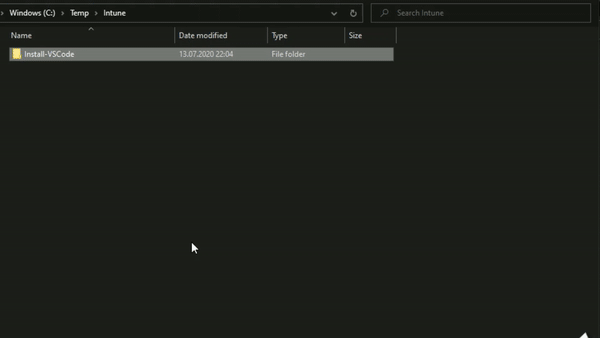
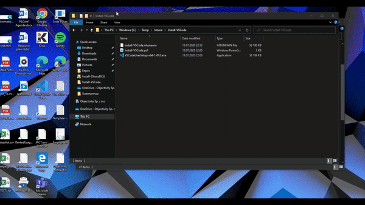

# Intune-App-Sandbox

[](https://www.powershellgallery.com/packages/Intune-App-Sandbox)
[](https://www.powershellgallery.com/packages/Intune-App-Sandbox)
[](LICENSE)

> 🧪 Test your Intune Win32 app deployment packages locally using Windows Sandbox before deploying to production.

A PowerShell module that enables you to pack and test [Win32 Content Prep Tool](https://github.com/microsoft/Microsoft-Win32-Content-Prep-Tool) packages (`.intunewin`) in an isolated Windows Sandbox environment—no need to deploy to actual devices during development.

## ✨ Features

- **One-click packaging** — Right-click any folder to create `.intunewin` packages
- **Isolated testing** — Run packages in Windows Sandbox without affecting your system
- **SYSTEM and user-context execution** — Test packages as SYSTEM or as the Sandbox user
- **PSADT support** — Automatic detection of PowerShell App Deployment Toolkit (v3 & v4) packages
- **Exit code capture** — Retrieve `$LASTEXITCODE` from script execution for validation
- **Toast notifications** — Visual progress feedback inside the Sandbox

## 📋 Prerequisites

- Windows 10/11 Pro, Enterprise, or Education
- PowerShell 5.1 or later
- Administrator privileges
- Windows Sandbox feature (will be enabled automatically if not already)

## 🚀 Installation

### Install from PowerShell Gallery

```powershell
Install-Module -Name Intune-App-Sandbox
```

### Initial Setup

Run the setup wizard to configure context menu integration:

```powershell
Add-SandboxShell
```

This will:
1. Enable the Windows Sandbox feature (if needed)
2. Create the operating folder at `C:\SandboxEnvironment`
3. Download the latest `IntuneWinAppUtil.exe` from Microsoft
4. Add right-click context menu options

You can choose which context menu items to install:
| Option | Description |
|--------|-------------|
| **Run test in Sandbox (SYSTEM)** | Test `.intunewin` files as SYSTEM |
| **Run test in Sandbox (User)** | Test `.intunewin` files as `WDAGUtilityAccount` |
| **Pack with IntunewinUtil** | Package folders into `.intunewin` format |
| **Both** | Install both options (recommended) |

## 🔄 Updating

```powershell
Update-Module -Name Intune-App-Sandbox
Update-SandboxShell
```

## 📖 Usage

### Packaging a Script

1. Create a folder with the **same name** as your install script:
   ```
   📁 Install-VSCode/
       📄 Install-VSCode.ps1
       📄 VSCodeSetup.exe
       📄 config.json
   ```

2. Right-click the folder → **Pack with IntunewinUtil**

3. The `.intunewin` file is created in the same folder



### Testing a Package

1. Right-click the `.intunewin` file → **Run test in Sandbox (SYSTEM)** or **Run test in Sandbox (User)**

2. Windows Sandbox launches and executes your script in the selected context

3. Review the results in the Sandbox environment

The VS Code extension can also launch `Invoke-Test.ps1` directly. Its `-PackagePath` parameter and optional `-RunAsUser` switch remain supported.



### PSADT Package Support

The module automatically detects PowerShell App Deployment Toolkit packages:

| Package Type | Detection | Setup File |
|--------------|-----------|------------|
| **PSADT v3** | Folder name contains `PSADT` | `Deploy-Application.exe` |
| **PSADT v4** | Folder name contains `PSADTv4` | `Invoke-AppDeployToolkit.exe` |
| **Standard** | Any other folder | `<FolderName>.ps1` |

## ⚙️ How It Works

### Architecture Overview

```
┌─────────────────────────────────────────────────────────────────┐
│                        HOST MACHINE                             │
├─────────────────────────────────────────────────────────────────┤
│  Right-click .intunewin                                         │
│         │                                                       │
│         ▼                                                       │
│  ┌─────────────────┐    ┌──────────────────────────────────┐   │
│  │ Invoke-Test.ps1 │───▶│ Generate .wsb configuration file │   │
│  └─────────────────┘    └──────────────────────────────────┘   │
│                                    │                            │
│         ┌──────────────────────────┘                            │
│         ▼                                                       │
│  ┌─────────────────────────────────────────────────────────────┐│
│  │                    WINDOWS SANDBOX                          ││
│  │  ┌───────────────────────────────────────────────────────┐  ││
│  │  │ 1. Decode .intunewin using IntuneWinAppUtilDecoder    │  ││
│  │  │ 2. Extract package contents to C:\Temp                │  ││
│  │  │ 3. Create scheduled task running as SYSTEM            │  ││
│  │  │ 4. Execute install script                             │  ││
│  │  │ 5. Capture $LASTEXITCODE to file                      │  ││
│  │  └───────────────────────────────────────────────────────┘  ││
│  └─────────────────────────────────────────────────────────────┘│
└─────────────────────────────────────────────────────────────────┘
```

### Sandbox Configuration

A `.wsb` file is dynamically generated with:

```xml
<Configuration>
  <VGpu>Enable</VGpu>
  <Networking>Enable</Networking>
  <MappedFolders>
    <MappedFolder>
      <HostFolder>C:\Path\To\Your\Package</HostFolder>
      <ReadOnly>true</ReadOnly>
    </MappedFolder>
    <MappedFolder>
      <HostFolder>C:\SandboxEnvironment\bin</HostFolder>
      <ReadOnly>true</ReadOnly>
    </MappedFolder>
  </MappedFolders>
  <LogonCommand>
    <Command>powershell.exe -WindowStyle Hidden -noprofile -executionpolicy bypass -Command ...</Command>
  </LogonCommand>
</Configuration>
```

### SYSTEM Context Execution

The module uses a scheduled task to run scripts as the SYSTEM user—the same context Intune uses for Win32 app deployments:

```powershell
# Nested PowerShell captures exit code
$Action = New-ScheduledTaskAction -Execute "powershell.exe" `
    -Argument '-ex bypass "powershell {& C:\Temp\Install.ps1};New-Item C:\Temp\$Lastexitcode.code -force"'
```

This nested approach ensures `$LASTEXITCODE` is captured correctly and saved to a file for verification.

## 📁 File Structure

```
C:\SandboxEnvironment\
└── bin\
    ├── IntuneWinAppUtil.exe        # Microsoft Win32 Content Prep Tool
    ├── IntuneWinAppUtilDecoder.exe # Package decoder for Sandbox
    ├── Invoke-IntunewinUtil.ps1    # Packing script
    ├── Invoke-Test.ps1             # Test orchestration script
    ├── New-WSBConfig.ps1           # Sandbox config generator
    ├── New-LogonScriptContent.ps1  # Logon script generator
    ├── New-ToastNotification.ps1   # Toast notification helper
    └── toast.xml                   # Toast notification template
```

## 🐛 Troubleshooting

| Issue | Solution |
|-------|----------|
| Context menu not appearing | Run `Add-SandboxShell` as Administrator |
| Sandbox won't start | Ensure Windows Sandbox feature is enabled |
| Package fails to decode | Verify the `.intunewin` file is not corrupted |
| Script not executing | Check that folder name matches script name |

## 🤝 Contributing

Contributions are welcome! Please feel free to submit a Pull Request.

## 📄 License

This project is licensed under the MIT License - see the [LICENSE](LICENSE) file for details.

## 👤 Author

**Maciej Horbacz** ([@UniverseCitiz3n](https://github.com/UniverseCitiz3n))

---

⭐ If this project helps you, consider giving it a star!
